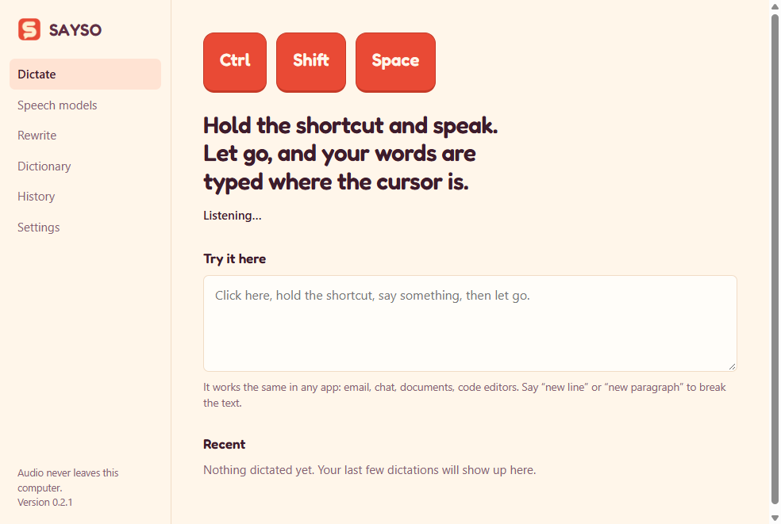
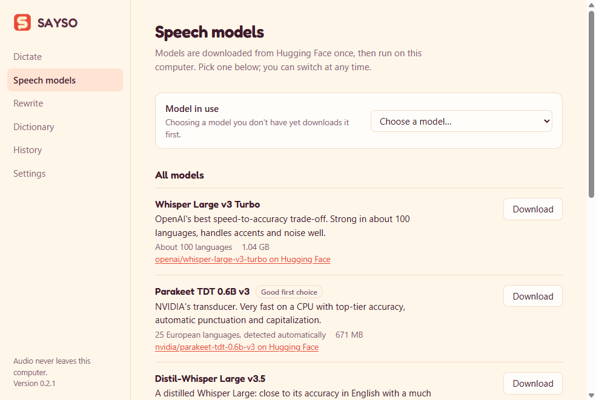
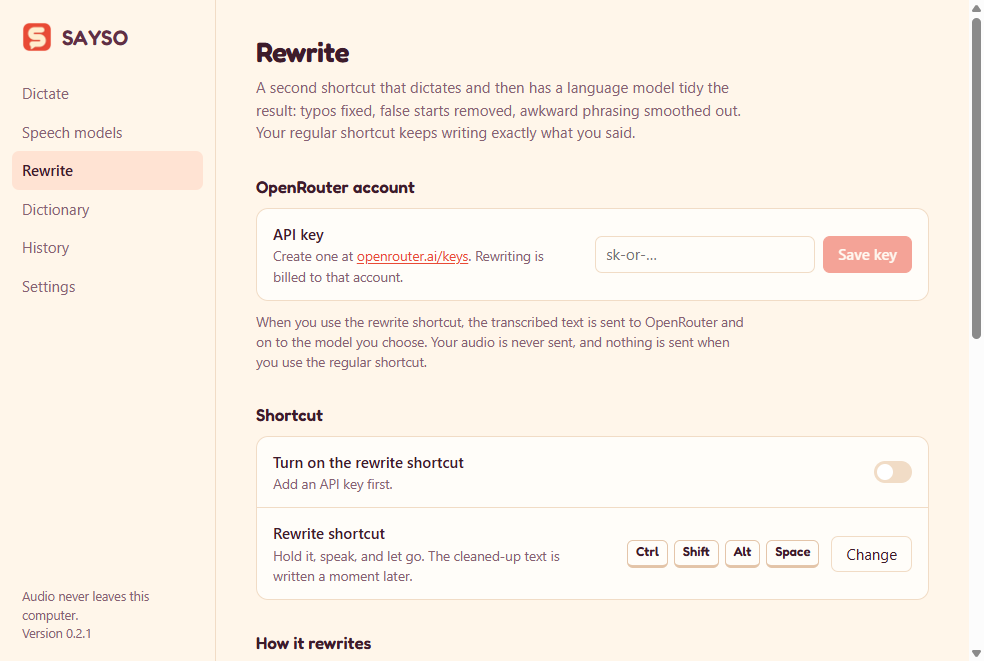
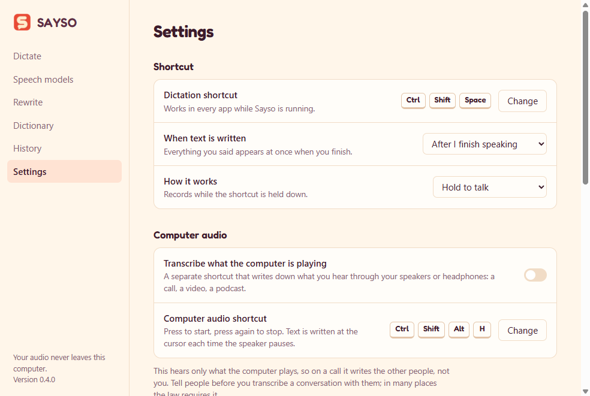

<p align="center"></p>

# Sayso

Hold a keyboard shortcut, speak, let go — your words are typed wherever the cursor is. Email, chat, documents, code
editors: any app.

Speech recognition runs entirely on your computer with open models you choose and download from
[Hugging Face](https://huggingface.co). No account, no subscription, and your audio never leaves the machine.

Runs on Windows, macOS and Linux.



While you speak, a small indicator at the bottom of the screen shows your voice level:


## Features

- **One global shortcut.** Hold to talk, or press once to start and again to stop. You pick the keys.
- **Text lands at the cursor.** Pasted in one go (your clipboard is put back afterwards), typed out key by key for
  apps that block pasting, or just copied.
- **Write as you speak.** Optionally, each sentence is typed as soon as you pause, while you keep talking, instead of
  everything arriving at the end.
- **Choose your model.** Seven speech models in a dropdown; picking one downloads it from Hugging Face with progress,
  cancel and resume. Switch whenever you like.
- **Rewrite shortcut.** An optional second shortcut that dictates and then has a language model tidy the result —
  typos, false starts, clumsy phrasing — using your own [OpenRouter](https://openrouter.ai) key and any model there.
- **Computer audio.** An optional third shortcut that writes down what you hear through your speakers or
  headphones — the other side of a call, a video, a podcast — at the cursor, as it is said.
- **Dictionary.** Fix names and jargon the model gets wrong, or define spoken shortcuts ("my address") that expand
  into longer text.
- **Spoken line breaks.** Say "new line" or "new paragraph".
- **Filler removal.** Optionally drop "um" and "uh".
- **History.** The last 300 dictations, searchable, stored locally. Can be turned off.
- **Listening indicator.** A small pill at the bottom of the screen shows your voice level and when text is being
  written. It never takes keyboard focus.
- **Long recordings.** Anything over 25 seconds is split at pauses with a voice-activity model, so there is no length
  limit in practice.
- **Fast, and stays fast.** Recognition typically takes a fraction of a second, and Sayso asks the system to keep
  it that way while other programs are busy. See [Performance](#performance).
- **Lives in the tray**, optionally starting at login, and tells you when an update is ready.

## Speech models

| Model | Languages | Download | Good for |
| --- | --- | --- | --- |
| [Parakeet TDT 0.6B v3](https://huggingface.co/nvidia/parakeet-tdt-0.6b-v3) | 25 European languages | 671 MB | Best all-round choice on a CPU |
| [Whisper Large v3 Turbo](https://huggingface.co/openai/whisper-large-v3-turbo) | About 100 | 1.04 GB | Widest language coverage |
| [Distil-Whisper Large v3.5](https://huggingface.co/distil-whisper/distil-large-v3.5) | English | 984 MB | Whisper-level English, faster |
| [Whisper Small](https://huggingface.co/openai/whisper-small) | About 100 | 375 MB | Older or low-memory machines |
| [Canary 180M Flash](https://huggingface.co/nvidia/canary-180m-flash) | English, Spanish, German, French | 207 MB | Small download, punctuated output |
| [SenseVoice Small](https://huggingface.co/FunAudioLLM/SenseVoiceSmall) | Chinese, Cantonese, English, Japanese, Korean | 240 MB | East Asian languages, very fast |
| [Moonshine Base](https://huggingface.co/UsefulSensors/moonshine-base) | English | 287 MB | Near-instant short phrases |



Models run through [sherpa-onnx](https://github.com/k2-fsa/sherpa-onnx) using 8-bit quantized ONNX exports. Each
model has its own license; check its model card before commercial use.

## Performance

Measured on a 16-core desktop CPU (Intel i7-13700F), no GPU involved, with the models' 8-bit versions:

| Model | 3-second dictation | 7-second dictation |
| --- | --- | --- |
| Parakeet TDT 0.6B v3 | about 0.17 s | about 0.4 s |
| Whisper Small | about 0.45 s | about 1.0 s |
| Whisper Large v3 Turbo | about 0.55 s | about 1.1 s |

Those were taken with a flight simulator running on the same machine. Three things keep the numbers there:

- **Priority.** The speech engine is a background process, and Windows slows those down when something else is
  busy. Sayso opts out. With a game running, a 7-second clip went from about 1.15 s to 0.45 s.
- **Threads.** Up to six, never more than the machine's physical cores. More than eight made every model slower.
- **Whisper padding.** Whisper appends silence before recognising; three seconds instead of the engine's longer
  default roughly halves its time on short dictations, with the same text.

Model choice matters more than any setting: Parakeet, Canary and SenseVoice are several times faster than Whisper
on the same audio. GPU acceleration was tested and gave no gain with these models, so Sayso runs on the CPU.

To measure your own machine, build from source and run:

```bash
core/target/release/sayso-core bench --data-dir <your Sayso data folder> --wav speech.wav
```

## Rewrite with a language model

Turn this on under **Rewrite**. Your regular shortcut keeps writing exactly what you said; the rewrite shortcut
(`Ctrl+Shift+Alt+Space` by default, `⌥⇧ Space` on macOS) transcribes on your computer and then sends the **text** to
OpenRouter to be cleaned up before it is written.

- You bring your own OpenRouter API key. It is stored encrypted by your operating system and is billed to your account.
- Pick any OpenRouter model and edit the instructions it follows ("use British spelling", "keep it casual").
- Only the transcribed text is sent, only when you use the rewrite shortcut. Audio is never sent.
- If the rewrite fails, your words are written as spoken, so nothing is lost.



## Settings

Change the shortcut, choose whether text is written after you finish or as you speak, pick a microphone, and choose
how text is delivered.



**Computer audio** (off by default, `Ctrl+Shift+Alt+H`) transcribes what your default sound output is playing
rather than the microphone, so on a call it writes the other people, not you. It works on Windows, and on Linux
when the sound system exposes a "Monitor" input; it is not available on macOS yet. Tell people before you
transcribe a conversation with them; in many places the law requires it.

Writing as you speak always uses press-to-start and press-to-stop. Text is typed while you are still talking, and
keys held down for hold-to-talk would turn that typing into other shortcuts.

## Privacy and security

- **Audio stays on your computer.** It is held in memory for the length of a dictation and never written to disk
  or sent anywhere.
- **The network is used for three things only:** downloading models from Hugging Face, checking GitHub for
  updates, and — only if you turn on the rewrite shortcut — sending the transcribed text to OpenRouter.
- **Downloads are verified.** Every model file is pinned to an exact revision and checked against a SHA-256
  checksum before it is used.
- **Your OpenRouter key is encrypted** by the operating system's credential store. The interface can set or remove
  it but cannot read it back.
- **Rewrite replies are not trusted.** Before a reply is written at your cursor, control characters are removed, it
  may not add line breaks you did not dictate, and a reply far longer than what you said is discarded.
- **Dictations are kept out of clipboard history** and cloud clipboard sync.
- **The interface is locked down.** It runs sandboxed, cannot navigate away from the app, and can call only a fixed
  list of engine functions; it cannot start a recording by itself.

Report vulnerabilities privately; see [SECURITY.md](SECURITY.md).

## Install

Download the installer for your system from the
[Releases page](https://github.com/gustavorubim/sayso/releases). GitHub shows only the first ten files; click
**Show all assets** to see the rest.

| System | File |
| --- | --- |
| Windows | `Sayso-…-windows-x64-setup.exe` |
| macOS, Apple silicon | `Sayso-…-mac-arm64.dmg` |
| macOS, Intel | `Sayso-…-mac-x64.dmg` |
| Linux | `Sayso-…-linux-x86_64.AppImage` or `Sayso-…-linux-amd64.deb` |

Then open the app, pick a model under **Speech models**, and hold the shortcut (`Ctrl+Shift+Space` on Windows and
Linux, `⌥ Space` on macOS).

Installing a newer version over an existing one replaces it and keeps your models, settings and history.

**Beta versions** appear on the Releases page marked "Pre-release". They are for trying changes early and are not
offered through the app's own updater unless you are already running a beta.

### Platform notes

- **Installers are not code-signed yet.** Windows SmartScreen will ask you to confirm ("More info" → "Run anyway").
  On macOS, right-click the app and choose Open the first time.
- **macOS** asks for two permissions: Microphone (to hear you) and Accessibility (to paste into other apps).
- **Linux** needs an X11 session. Global shortcuts and simulated paste are not available on Wayland yet.
- **Updates.** Windows and Linux AppImage builds download new versions themselves and offer **Restart to update**.
  On macOS and with the `.deb`, the app tells you a new version is out and links to the download.
- **Coming from "Shortcut to Text"?** Sayso is the same app under a new name. It moves your models and settings over
  the first time it starts. Uninstall the old app yourself; the Sayso installer does not remove it.

## Build from source

You need [Node.js](https://nodejs.org) 22 or newer and [Rust](https://rustup.rs) (stable).

```bash
git clone https://github.com/gustavorubim/sayso.git
cd sayso
npm install
npm run dev
```

`npm run dev` compiles the Rust core, then starts the app with hot reload for the interface. It uses its own data
folder, so it can run next to an installed copy.

Linux also needs: `sudo apt install pkg-config libasound2-dev libx11-dev libxi-dev libxtst-dev libxdo-dev`.

To build an installer for the system you are on: `npm run dist` (output in `dist/`).

Before opening a pull request, run what CI runs:

```bash
npm run check
```

```bash
npm run core:test
```

More in [CONTRIBUTING.md](CONTRIBUTING.md) and [docs/ARCHITECTURE.md](docs/ARCHITECTURE.md).

## How it is built

- **`core/`** — a Rust program that owns everything time-critical: the global shortcuts, microphone capture, speech
  recognition, model downloads, pasting, and the optional rewrite request.
- **`src/`** — an Electron app (TypeScript and React) for the settings window, tray icon, and listening indicator.

The two talk over a small JSON protocol, so the core can be reused by other front ends later.

### How changes are checked

- **Every pull request:** formatting, lint and unit tests for both halves, plus a smoke test that builds the real
  app, starts it, and has it check itself — the engine runs, every screen opens, the icons are in the package.
- **Every release:** all of that on Windows, macOS and Linux for the tagged commit, before any installer is built.
- **Every week:** an audit of the dependencies against known vulnerabilities.

## Roadmap

Shipped so far: dictation at the cursor, seven downloadable models, writing as you speak, the rewrite shortcut,
computer-audio transcription, in-app update notices, and the performance and security work described above.

Next, roughly in order:

- **Signed installers** for Windows and macOS, which removes the install warnings and enables self-update on macOS
- **Computer audio on macOS**, and mixing in the microphone so both sides of a call are written
- **Word-by-word text** with streaming models, not only at pauses
- **Rewriting with a local language model**, with no network at all
- **Per-app settings**, such as a different model or rewrite style in your code editor
- **Wayland support** on Linux
- **A transcript window** as an alternative to typing at the cursor for long recordings

Considered and set aside: GPU acceleration. It works, but gave no speed-up with the 8-bit models Sayso uses; it
would need full-precision models several times the size. It may return if there is demand.

## License

[MIT](LICENSE). Speech models are licensed separately by their authors.
